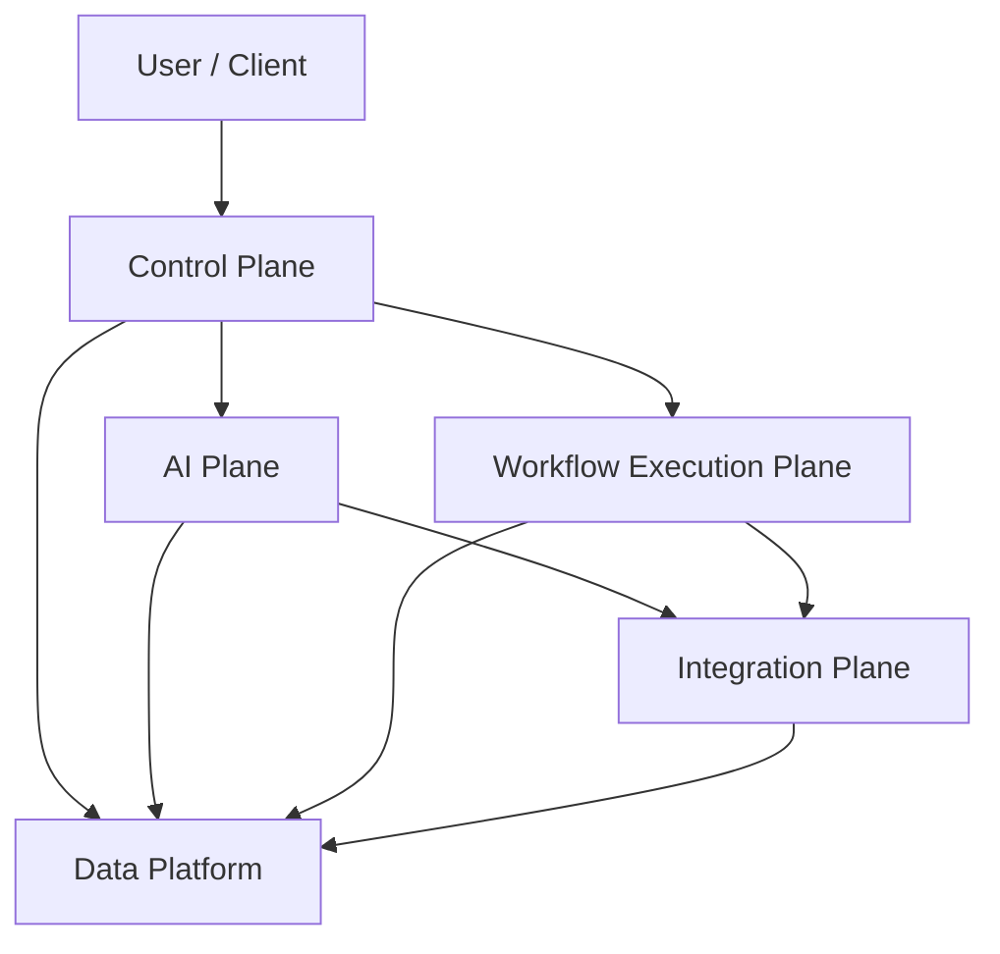
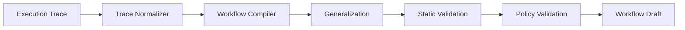
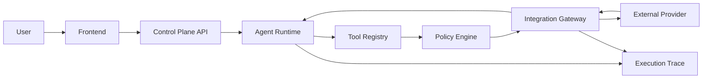
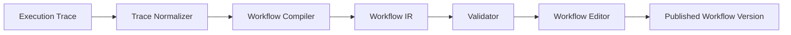
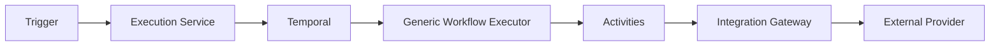
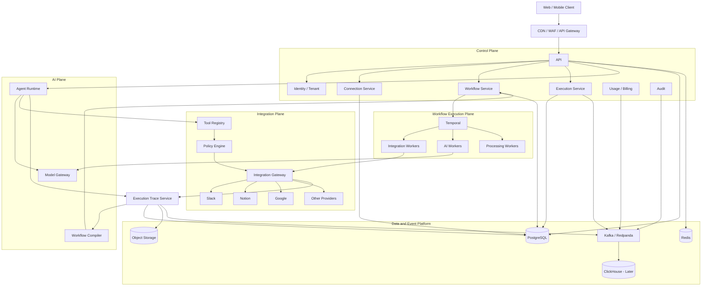

# AgentWorkflow — System Design Specification

**Document type:** Architecture & Engineering Specification  
**Purpose:** Primary design document for implementation by coding agents and engineering teams  
**Status:** Initial architecture baseline  
**System:** AgentWorkflow

---

## 1. Executive Summary

AgentWorkflow is a commercial-grade, multi-tenant agentic automation platform.

The platform supports two primary use cases:

1. **Agent-driven application interaction**
   - Users connect external providers such as Slack, Notion, Google Drive, Gmail, and similar SaaS applications.
   - Users interact with an AI Agent through natural language.
   - The Agent selects and executes tools against the user's connected applications.
   - Every significant execution step is captured as a structured product-level execution trace.

2. **Trace-to-Workflow automation**
   - Users can convert an Agent execution trace into a reusable Workflow.
   - A dedicated Workflow Compiler generalizes the original execution into a versioned Workflow Definition.
   - Workflows can be edited, published, triggered manually, scheduled, retried, observed, and reused.
   - Workflow execution must be durable and deterministic except for explicitly declared AI nodes.

The core architectural principle is to **separate Agent execution from Workflow execution**.

Agent execution is probabilistic and dynamic.

Workflow execution is structured, versioned, observable, and durable.

The platform must therefore be designed as multiple cooperating planes rather than one large backend service.

---

# 2. Core Architectural Principles

The following principles are architectural invariants and should not be violated without an explicit architecture decision.

## 2.1 Separate Agent Runtime and Workflow Runtime

Agent execution and Workflow execution are fundamentally different.

### Agent Runtime

Characteristics:

- probabilistic;
- LLM-driven;
- dynamic tool selection;
- may revise plans during execution;
- may execute a variable number of steps;
- optimized for user intent completion.

### Workflow Runtime

Characteristics:

- structured;
- versioned;
- reproducible;
- retryable;
- schedulable;
- inspectable;
- durable;
- optimized for reliable automation.

Temporal is the Workflow Runtime.

Temporal is **not** the Agent Runtime.

---

## 2.2 Separate Product Execution Trace from Infrastructure Trace

AgentWorkflow maintains two distinct tracing concepts.

### Execution Trace

Product-level trace used for:

- representing Agent reasoning and tool execution;
- debugging Agent behavior;
- replay and inspection;
- trace-to-workflow conversion;
- execution history;
- user-facing run visualization.

### OpenTelemetry Trace

Infrastructure-level trace used for:

- distributed tracing;
- latency analysis;
- service dependency analysis;
- incident debugging;
- performance monitoring.

The two trace types must remain distinct but correlated.

Recommended correlation identifiers:

- `execution_trace_id`
- `otel_trace_id`

---

## 2.3 Workflows Are Immutable After Publication

Published workflow versions are immutable.

A Workflow may have:

- one editable draft;
- multiple immutable published versions.

Every Workflow execution must reference one exact Workflow version.

An execution created from version `v2` must continue to use `v2` even if `v3` is published later.

This requirement is necessary for:

- reproducibility;
- debugging;
- auditability;
- rollback;
- historical correctness.

---

## 2.4 Credentials Must Never Be Exposed to the Agent or LLM

The Agent Runtime must never receive provider access tokens, refresh tokens, API secrets, or credential material.

The Agent may reference a logical connection identifier.

Credential resolution, decryption, OAuth refresh, scope validation, and outbound provider calls are responsibilities of the Integration Platform.

---

## 2.5 Integration Side Effects Must Be Retry-Safe

External operations may be retried because of:

- Temporal Activity retry;
- worker restart;
- network failure;
- provider timeout;
- ambiguous response delivery.

Any operation that creates external side effects must therefore define an idempotency strategy.

Examples include:

- sending a Slack message;
- creating a Notion page;
- uploading a file;
- creating a calendar event;
- sending an email.

Retry behavior must never assume that failure to receive a response means the provider operation did not happen.

---

# 3. High-Level System Decomposition

AgentWorkflow is divided into five major architectural areas.

1. **Control Plane**
2. **AI Plane**
3. **Integration Plane**
4. **Workflow Execution Plane**
5. **Data and Event Platform**

Conceptually:



---

# 4. Recommended Technology Stack

## 4.1 Frontend

Recommended stack:

- Next.js
- React
- TypeScript
- React Flow / `@xyflow/react`
- Server-Sent Events for execution progress where unidirectional streaming is sufficient
- WebSocket only where true bidirectional real-time communication is required

Responsibilities:

- Agent chat UI;
- connection management;
- workflow editor;
- workflow execution viewer;
- execution trace viewer;
- workflow schedule management;
- tenant/workspace administration;
- billing and usage pages;
- approval interactions;
- provider setup flows.

---

## 4.2 Control Plane Backend

Recommended language:

- Go

Primary responsibilities:

- authentication;
- organization management;
- workspace management;
- RBAC;
- connection metadata;
- OAuth orchestration;
- workflow CRUD;
- workflow publication;
- workflow version management;
- execution requests;
- schedule management;
- approval management;
- usage accounting;
- billing integration;
- audit management;
- webhook ingress;
- notification coordination.

External communication:

- REST APIs for public/client-facing operations;
- SSE for execution progress;
- gRPC with Protobuf for internal synchronous service communication where appropriate.

---

## 4.3 AI Plane

Recommended language:

- Python

Primary responsibilities:

- Agent Runtime;
- model interaction;
- tool selection;
- planning;
- reasoning orchestration;
- trace normalization;
- trace-to-workflow compilation;
- workflow generalization;
- AI evaluation;
- model abstraction;
- prompt lifecycle management;
- future RAG and memory capabilities.

The AI Plane must not become responsible for:

- OAuth token storage;
- durable workflow execution;
- user authentication;
- billing source of truth;
- workflow version persistence logic;
- direct provider credential management.

---

## 4.4 Workflow Runtime

Recommended engine:

- Temporal

Temporal is responsible for:

- durable Workflow execution;
- Workflow state recovery;
- Activities;
- retries;
- backoff;
- timers;
- scheduled execution;
- long-running execution;
- worker task distribution;
- pause/wait patterns;
- Human-in-the-Loop waiting;
- deterministic Workflow orchestration.

Temporal should execute a **generic Workflow Execution Plan**, not generate a separate application code implementation for every user-created Workflow.

---

## 4.5 Primary Database

Recommended:

- PostgreSQL

PostgreSQL is the main transactional source of truth.

Primary categories of data:

- users;
- organizations;
- workspaces;
- memberships;
- roles and permissions;
- provider metadata;
- connections;
- agents;
- conversations;
- messages;
- execution traces;
- trace steps;
- tool invocations;
- workflow definitions;
- workflow versions;
- workflow schedules;
- workflow executions;
- node executions;
- approvals;
- audit records;
- usage records;
- billing references.

---

## 4.6 Redis

Redis is used only for ephemeral or cache-oriented state.

Suitable use cases:

- cache;
- rate limiting;
- temporary locks;
- short-lived session state;
- provider quota state;
- SSE/WebSocket routing metadata;
- temporary deduplication data.

Redis must not be the source of truth for:

- workflow definitions;
- workflow execution state;
- tenant membership;
- billing;
- long-term trace history.

---

## 4.7 Object Storage

Recommended:

- S3-compatible object storage

Suitable data:

- file attachments;
- large provider responses;
- large tool outputs;
- raw trace payloads;
- uploaded documents;
- generated artifacts;
- workflow export files;
- retained execution artifacts.

Transactional databases should store references and metadata rather than very large payloads.

---

## 4.8 Event Backbone

Recommended:

- Kafka or Redpanda

Primary role:

- domain event distribution.

Kafka must not duplicate the orchestration responsibilities of Temporal.

Suitable events include:

- WorkflowExecutionStarted;
- WorkflowExecutionCompleted;
- WorkflowExecutionFailed;
- ToolInvocationCompleted;
- UsageRecorded;
- BillingUsageCreated;
- AuditEventCreated;
- NotificationRequested;
- ConnectorStateChanged.

Typical consumers:

- billing;
- analytics;
- audit;
- notifications;
- data warehouse pipelines;
- product telemetry.

---

## 4.9 Analytics Store

Recommended initial approach:

- PostgreSQL for early-stage operational analytics.

Recommended later-stage approach:

- ClickHouse when trace and event volume becomes large.

ClickHouse is appropriate when the system requires:

- high-volume trace analytics;
- high-cardinality execution analytics;
- large event histories;
- low-latency aggregate queries;
- product usage analytics.

---

## 4.10 Observability

Recommended stack:

- OpenTelemetry;
- Prometheus;
- Grafana;
- Tempo;
- centralized structured logging.

The observability architecture must support:

- metrics;
- traces;
- logs;
- correlation IDs;
- execution IDs;
- tenant-safe operational diagnostics.

---

## 4.11 Infrastructure

Recommended:

- Docker;
- Kubernetes;
- Terraform;
- Helm;
- ArgoCD.

Production infrastructure should support independent scaling of:

- API services;
- Agent workers;
- Workflow workers;
- Integration workers;
- AI workers;
- provider-specific workloads.

---

# 5. Architectural Planes

## 5.1 Control Plane

The Control Plane manages user-facing configuration and system metadata.

Primary bounded contexts:

- Identity
- Tenant
- Workspace
- RBAC
- Connections
- Workflow Management
- Schedule Management
- Execution Management
- Approval Management
- Usage
- Billing
- Audit

The Control Plane should not execute external integration logic directly.

It should delegate provider operations through the Integration Plane.

---

## 5.2 AI Plane

The AI Plane contains all AI-specific functionality.

Major components:

### Agent Runtime

Responsibilities:

- interpret user intent;
- create execution plans dynamically;
- select appropriate tools;
- request tool execution;
- consume tool outputs;
- continue multi-step reasoning;
- generate final responses.

### Model Gateway

Responsibilities:

- normalize access to supported LLM providers;
- model routing;
- model configuration;
- quota management;
- model observability;
- prompt/version attribution;
- fallback policies where explicitly configured.

### Workflow Compiler

Responsibilities:

- consume Execution Traces;
- identify reusable actions;
- remove execution-specific noise;
- infer Workflow inputs;
- infer constants;
- infer dependencies;
- infer branch logic;
- infer data mappings;
- produce Workflow IR;
- validate structural correctness;
- produce draft Workflow versions.

The Workflow Compiler must produce a draft that can be reviewed before publication.

---

# 6. Integration Plane

The Integration Plane is a first-class subsystem.

Supported providers may include:

- Slack;
- Notion;
- Google Drive;
- Gmail;
- Google Calendar;
- Microsoft 365;
- GitHub;
- Linear;
- Jira;
- Dropbox;
- custom HTTP integrations.

The Integration Plane must not be implemented as provider-specific conditionals spread across the application.

A Connector abstraction is required.

---

## 6.1 Connector Model

A Connector represents one external provider integration.

A Connector contains:

- connector metadata;
- authentication definition;
- supported tools;
- webhook capabilities;
- event capabilities;
- provider rate-limit profile;
- provider error mapping;
- version information.

Each Connector is independently versioned.

---

## 6.2 Tool Model

A Tool is an action exposed by a Connector.

Every Tool should define:

- unique tool identifier;
- provider identifier;
- tool version;
- semantic description;
- input schema;
- output schema;
- required scopes;
- side-effect classification;
- retry policy;
- timeout policy;
- rate-limit profile;
- idempotency requirements;
- permission requirements;
- approval requirements.

Recommended side-effect classes:

- `NONE`
- `READ`
- `WRITE`
- `DESTRUCTIVE`

The classification is used by policy and approval systems.

---

## 6.3 Integration Gateway

All provider calls pass through the Integration Gateway.

Responsibilities:

- resolve connection;
- verify tenant ownership;
- verify user/workspace authorization;
- load encrypted credential material;
- decrypt credentials;
- refresh OAuth tokens;
- validate scopes;
- apply provider rate limits;
- apply retry rules;
- apply idempotency rules;
- execute provider request;
- normalize provider errors;
- emit trace data;
- record usage where applicable.

Neither the Agent Runtime nor Temporal Workflow code should directly own provider credentials.

---

## 6.4 Connection Model

A Connection represents a user or workspace authorization to an external provider.

A Connection should be logically associated with:

- tenant;
- workspace;
- owner or sharing policy;
- provider;
- OAuth installation;
- granted scopes;
- encrypted credentials;
- credential expiry;
- refresh state;
- provider account identity;
- connection status.

Connection status should support at least:

- active;
- expired;
- revoked;
- missing_scope;
- reconnect_required;
- disabled.

---

# 7. Policy and Permission Layer

Every tool execution must pass through a policy decision before reaching the external provider.

Policy evaluation should consider:

- tenant;
- workspace;
- current user;
- current Agent;
- workflow identity;
- connection;
- provider;
- tool;
- required scopes;
- side-effect class;
- organization policy;
- approval policy;
- usage quota;
- plan restrictions.

The policy layer must support:

- allow;
- deny;
- require approval.

Potential destructive operations should be explicitly classifiable and policy-controlled.

---

# 8. Human Approval

AgentWorkflow must support Human-in-the-Loop execution.

Examples:

- sending an external email;
- deleting a file;
- publishing a document;
- executing a high-cost action;
- posting to a public Slack channel;
- performing a sensitive administrative action.

Approval state is part of Workflow execution state.

The Workflow Runtime must be able to wait durably for approval without holding application memory or compute resources.

Approval records should include:

- execution;
- workflow node;
- requested action;
- approver scope;
- requester;
- request timestamp;
- decision;
- decision timestamp;
- decision actor;
- relevant action preview.

---

# 9. Execution Trace Model

Execution Trace is a product data model.

It captures how an Agent or Workflow execution occurred.

A trace may include:

- user request;
- Agent steps;
- tool selection;
- tool invocations;
- tool outputs;
- model invocations;
- intermediate state;
- branch decisions;
- errors;
- retries;
- approvals;
- final response.

---

## 9.1 Tool Invocation Trace

Each Tool Invocation should capture metadata equivalent to:

- tool call identity;
- trace identity;
- parent step identity;
- provider;
- tool identifier;
- tool version;
- connection identifier;
- input schema version;
- input payload or reference;
- output schema version;
- output payload or reference;
- start time;
- completion time;
- status;
- normalized error type;
- retry attempt;
- side-effect classification;
- idempotency key;
- OpenTelemetry trace identifier;
- OpenTelemetry span identifier.

Large inputs and outputs should be stored in object storage with references persisted in PostgreSQL.

---

# 10. Trace-to-Workflow Compilation

Trace-to-Workflow is a core platform capability.

The conversion pipeline is:



---

## 10.1 Trace Normalization

Normalization removes runtime-specific noise and creates a canonical representation.

Potential runtime-specific data includes:

- provider response metadata;
- transient request identifiers;
- timestamps;
- retry artifacts;
- temporary URLs;
- generated request IDs;
- non-semantic model chatter.

Normalization must preserve data that affects behavior.

---

## 10.2 Generalization

Generalization determines what should be reusable.

The compiler must distinguish between:

- constants;
- workflow inputs;
- node outputs;
- connection references;
- expressions;
- branch conditions;
- optional parameters.

For example, values that were hard-coded in one Agent execution may become reusable Workflow inputs.

The compiler should not automatically publish generalized Workflows.

Its output is a draft.

---

# 11. Workflow Intermediate Representation

The Workflow Intermediate Representation, or Workflow IR, is one of the most important system contracts.

The UI must not directly define Temporal application code.

Instead:

```text
User Workflow
    ↓
Workflow Definition
    ↓
Validation
    ↓
Workflow IR
    ↓
Execution Plan
    ↓
Temporal Runtime
```

Workflow IR must be:

- deterministic in structure;
- versioned;
- serializable;
- schema validated;
- provider-independent where possible;
- executable by a generic Workflow Runtime;
- suitable for static analysis;
- suitable for UI rendering;
- suitable for auditing.

---

## 11.1 Workflow Node Types

The platform should support an extensible node type system.

Initial node families:

- Trigger
- Tool
- LLM
- Transform
- Condition
- Parallel
- Loop
- Wait
- Human Approval
- Subworkflow

Additional node types may be introduced through Workflow schema versioning.

---

## 11.2 Workflow Data Flow

Node input data may originate from:

- Workflow inputs;
- previous node outputs;
- constants;
- connection metadata;
- environment-safe runtime metadata;
- expressions.

Node outputs must be schema-addressable for downstream mapping.

The system should avoid arbitrary unrestricted user code as the default expression mechanism.

Prefer a controlled expression system with:

- deterministic evaluation;
- execution limits;
- safe access to Workflow state;
- no arbitrary file system access;
- no unrestricted networking.

---

# 12. Workflow Lifecycle

Recommended Workflow states:

- draft;
- published;
- archived.

A Workflow contains:

- stable Workflow identity;
- one current editable draft;
- zero or more published immutable versions.

Publishing creates a new immutable Workflow version.

Editing an existing published version is prohibited.

---

# 13. Workflow Execution Model

A Workflow execution references:

- tenant;
- workspace;
- workflow;
- workflow version;
- trigger type;
- inputs;
- connection bindings;
- execution policy;
- initiating principal;
- start time.

Execution state should support:

- pending;
- running;
- waiting;
- waiting_for_approval;
- succeeded;
- failed;
- cancelled;
- timed_out.

Individual node executions should maintain independent state.

---

## 13.1 Generic Workflow Executor

Temporal should run a generic Workflow Executor capable of interpreting a validated Execution Plan.

The runtime should not require dynamically creating or deploying new application code for every user-defined Workflow.

The Executor is responsible for:

- loading the immutable Workflow version;
- validating runtime inputs;
- resolving the next executable nodes;
- coordinating parallel branches;
- invoking Activities;
- waiting for timers;
- waiting for approvals;
- handling retries;
- recording node execution state;
- emitting execution events;
- completing the Workflow.

---

# 14. Temporal Responsibilities

Temporal is the durable execution substrate.

Temporal should manage:

- Workflow state;
- execution history;
- task distribution;
- retries;
- retry backoff;
- timers;
- schedules;
- Activity execution;
- long-running waiting;
- worker crash recovery.

External side effects must occur in Activities or through Activity-controlled Integration execution.

Workflow orchestration logic must remain deterministic.

---

## 14.1 Task Queue Strategy

Task Queues should represent execution capabilities.

Initial examples:

- integration-read;
- integration-write;
- ai-tasks;
- data-processing;
- notifications.

As usage grows, queues may become more specialized.

Examples:

- integration-slack;
- integration-google;
- integration-notion;
- gpu-ai;
- cpu-heavy.

Task Queue design should permit independent worker scaling.

---

# 15. Retry and Idempotency

Retry is part of the platform contract.

Each Tool definition must specify retry behavior.

The platform must differentiate errors such as:

- transient network failure;
- provider rate limit;
- provider unavailable;
- authentication failure;
- missing scope;
- invalid user input;
- permission denied;
- business-rule failure;
- permanent provider error.

Retry policies must not retry permanent errors.

---

## 15.1 Idempotency

External side effects must support an idempotency strategy.

The logical idempotency identity should be derived from stable execution semantics such as:

- execution identity;
- node identity;
- operation identity.

The exact approach may vary by provider.

Possible strategies:

- provider-native idempotency token;
- application-side deduplication record;
- external object lookup;
- transactional outbox-style coordination;
- deterministic operation reference.

Idempotency records must be tenant-scoped.

---

# 16. Scheduling

Workflow scheduling should use Temporal Schedule functionality.

Supported scheduling capabilities should eventually include:

- one-time schedules;
- recurring schedules;
- timezone-aware schedules;
- pause/resume;
- immediate trigger;
- backfill where appropriate.

Schedules reference immutable Workflow versions or an explicitly defined version-selection policy.

Version behavior must never be ambiguous.

---

# 17. Workflow Triggers

Potential trigger types:

- manual;
- schedule;
- API;
- webhook;
- provider event;
- subworkflow;
- internal system event.

Trigger processing must include:

- authentication;
- tenant resolution;
- deduplication;
- input validation;
- version resolution;
- execution creation;
- audit emission.

---

# 18. Data Ownership

Each bounded context should own its business rules.

Suggested ownership:

## Identity / Tenant

Owns:

- users;
- organizations;
- workspaces;
- memberships;
- roles.

## Connections

Owns:

- connector installations;
- provider identities;
- OAuth state;
- encrypted credentials;
- granted scopes.

## Agent

Owns:

- agents;
- conversations;
- messages;
- Agent configurations.

## Trace

Owns:

- execution traces;
- trace steps;
- tool invocation trace metadata.

## Workflow

Owns:

- workflow definitions;
- workflow drafts;
- workflow versions;
- validation status.

## Execution

Owns:

- execution records;
- node execution records;
- approvals;
- execution-facing status.

## Billing

Owns:

- usage ledger;
- billable events;
- plan limits;
- billing provider references.

Service boundaries may share one PostgreSQL cluster initially, but ownership must remain explicit.

Direct cross-domain table mutation should be avoided.

---

# 19. Multi-Tenancy

AgentWorkflow is multi-tenant by default.

Every tenant-owned resource must contain an unambiguous tenant boundary.

Typical hierarchy:

```text
Organization
    ↓
Workspace
    ↓
Resources
```

Tenant-aware authorization must exist in:

- API layer;
- application/domain layer;
- database access;
- object storage pathing;
- cache keys;
- event payloads;
- logs;
- trace access;
- integration access.

PostgreSQL Row-Level Security may be used as defense-in-depth, but application-level authorization remains mandatory.

Cross-tenant data access must be treated as a critical security incident.

---

# 20. Authentication and Authorization

The platform must distinguish:

- authenticated identity;
- organization membership;
- workspace membership;
- role;
- resource ownership;
- provider connection ownership;
- Workflow execution identity.

Authorization decisions must not rely only on frontend visibility.

Required authorization concepts:

- user;
- service account;
- Workflow principal;
- system principal.

---

# 21. Secrets and Credential Security

Provider credentials should use envelope encryption with a managed KMS or equivalent secure key-management system.

Credential handling rules:

- never log raw credentials;
- never expose credentials to LLM prompts;
- never expose credentials to frontend clients;
- minimize decrypted credential lifetime;
- enforce provider scopes;
- rotate keys;
- support credential revocation;
- audit connection changes.

Production deployment may use:

- cloud secret manager;
- Vault;
- managed KMS.

---

# 22. Provider Rate Limiting

External providers impose different quotas.

The Integration Plane must support rate limits at multiple levels:

- provider;
- application installation;
- tenant;
- connection;
- user;
- tool.

Rate-limit handling should support:

- preemptive throttling;
- provider Retry-After semantics;
- queueing where appropriate;
- retry backoff;
- quota telemetry.

---

# 23. Circuit Breaking and Provider Failure

External providers are unreliable dependencies.

The platform must tolerate:

- provider outage;
- provider latency spikes;
- token expiration;
- API deprecation;
- quota exhaustion;
- webhook delivery duplication;
- webhook delivery delay.

Provider adapters should expose normalized failure types to the rest of the platform.

---

# 24. Webhook Architecture

Webhook ingress must not directly execute large application workflows synchronously.

Recommended logical flow:

```text
Provider
   ↓
Webhook Gateway
   ↓
Authentication / Signature Verification
   ↓
Deduplication
   ↓
Normalized Event
   ↓
Trigger Resolution
   ↓
Workflow Execution
```

Webhook handling must support:

- provider signature validation;
- replay prevention;
- duplicate event handling;
- tenant resolution;
- event versioning.

---

# 25. Realtime Execution Progress

Frontend clients should observe execution through the Execution Service.

Workers should not be queried directly by clients.

Recommended logical flow:

```text
Worker / Temporal
      ↓
Execution Event
      ↓
Execution Service
      ↓
SSE
      ↓
Frontend
```

The UI should be able to display:

- current execution status;
- node state;
- retry state;
- waiting state;
- approval state;
- elapsed time;
- errors;
- completed outputs where safe.

---

# 26. Agent-to-Tool Execution Flow

High-level flow:



Execution sequence:

1. User sends a natural-language request.
2. Control Plane authenticates the request and resolves tenant/workspace context.
3. Agent Runtime interprets the request.
4. Agent Runtime selects a Tool.
5. Tool Registry resolves the Tool definition and schema.
6. Policy Engine evaluates authorization and approval requirements.
7. Integration Gateway resolves the user's Connection.
8. Integration Gateway executes the provider request.
9. The result returns to Agent Runtime.
10. Agent may continue with additional Tool calls.
11. Every significant execution step is written to the Execution Trace.
12. Agent produces the final user-facing response.

---

# 27. Trace-to-Workflow Flow



Execution sequence:

1. User selects an Agent execution.
2. Trace Service loads the structured Execution Trace.
3. Trace Normalizer converts runtime events into a canonical representation.
4. Workflow Compiler identifies reusable operations.
5. Compiler identifies inputs, constants, dependencies, data mappings, and conditions.
6. Compiler creates Workflow IR.
7. Structural validation checks the Workflow.
8. Policy validation detects disallowed or high-risk operations.
9. A Workflow draft is presented to the user.
10. User may modify the Workflow.
11. Publishing creates a new immutable Workflow version.

---

# 28. Workflow Execution Flow



Execution sequence:

1. Trigger is received.
2. Execution Service authenticates and validates the trigger.
3. Exact Workflow version is resolved.
4. Execution record is created.
5. Temporal Workflow is started.
6. Generic Workflow Executor loads the immutable execution plan.
7. Runnable nodes are evaluated.
8. Activities execute node operations.
9. External provider operations pass through the Integration Gateway.
10. Node execution state is persisted.
11. Execution events are emitted for UI, audit, usage, billing, and analytics.
12. Workflow completes, fails, waits, or is cancelled according to runtime state.

---

# 29. Full High-Level Architecture



---

# 30. Backend Code Organization

The system should use clear bounded contexts and dependency boundaries.

Avoid organizing the entire backend around only technical folders such as:

- controllers;
- services;
- repositories;
- models.

Prefer business capability boundaries.

Recommended top-level logical domains:

- identity;
- tenant;
- connection;
- integration;
- agent;
- trace;
- workflow;
- execution;
- approval;
- usage;
- billing;
- audit;
- notification.

Each domain should follow a layered or hexagonal structure.

Logical dependency direction:

```text
Transport / Infrastructure
          ↓
Application
          ↓
Domain
```

The Domain layer must not depend directly on:

- PostgreSQL;
- Redis;
- Temporal;
- Kafka;
- HTTP framework;
- external provider SDK;
- cloud SDK.

Infrastructure implements interfaces required by the application/domain layers.

---

# 31. Recommended Repository Shape

A monorepo is recommended initially.

Logical structure:

```text
agentworkflow/
│
├── apps/
│   └── web/
│
├── services/
│   ├── api/
│   ├── identity/
│   ├── connection/
│   ├── integration/
│   ├── workflow/
│   ├── execution/
│   ├── trace/
│   └── billing/
│
├── ai/
│   ├── agent-runtime/
│   ├── workflow-compiler/
│   └── evaluations/
│
├── workers/
│   ├── integration/
│   ├── workflow/
│   └── ai/
│
├── packages/
│   ├── connector-sdk/
│   ├── workflow-schema/
│   ├── tool-schema/
│   ├── event-schema/
│   └── observability/
│
├── proto/
│
├── infra/
│   ├── terraform/
│   ├── kubernetes/
│   └── helm/
│
└── docs/
```

This structure describes ownership boundaries and does not imply that every folder must initially deploy as an independent microservice.

---

# 32. Logical Services vs Physical Services

AgentWorkflow should maintain strong logical separation but avoid premature microservice fragmentation.

Initial production deployments may reasonably contain a smaller number of independently deployable services such as:

- Control Plane API;
- Agent Runtime;
- Integration Service;
- Workflow Worker;
- AI Worker.

Domains should be independently extractable later.

A domain should be physically split only when justified by:

- independent scaling needs;
- security isolation;
- ownership boundaries;
- release cadence;
- reliability requirements;
- different runtime requirements.

---

# 33. Event Design

Domain events should be versioned.

Every event should include sufficient context to support downstream processing.

Typical metadata:

- event ID;
- event type;
- event schema version;
- tenant ID;
- workspace ID where relevant;
- resource ID;
- execution ID where relevant;
- correlation ID;
- causation ID;
- creation timestamp.

Events must not contain decrypted credentials.

Sensitive user data should be minimized.

---

# 34. Audit Logging

Audit events are security and compliance records.

Audit events should be immutable or append-only.

Audit examples:

- user logged in;
- connection created;
- connection revoked;
- Workflow published;
- Workflow schedule created;
- Workflow manually triggered;
- destructive Tool approved;
- organization role changed;
- credential configuration changed.

Audit is distinct from:

- application logs;
- Execution Traces;
- OpenTelemetry traces.

---

# 35. Usage and Billing

Usage accounting should be event-driven.

Possible billable dimensions:

- LLM tokens;
- Workflow runs;
- Agent runs;
- premium connector calls;
- compute duration;
- storage;
- AI model tier;
- high-cost processing node usage.

Billing records should be derived from an append-oriented usage ledger.

Billing correctness must not depend on frontend events.

---

# 36. Observability Requirements

Every request and execution should support correlation across services.

Important identifiers:

- request ID;
- correlation ID;
- tenant ID;
- workspace ID;
- execution ID;
- execution trace ID;
- workflow ID;
- workflow version ID;
- Temporal Workflow ID;
- OpenTelemetry trace ID.

Metrics should cover:

## API

- request latency;
- error rate;
- request volume;
- authentication failures.

## Agent

- Agent run duration;
- model latency;
- Tool calls per run;
- Agent failure rate;
- model token usage.

## Workflow

- execution duration;
- success rate;
- failure rate;
- cancellation rate;
- retry count;
- queue wait duration.

## Integration

- provider latency;
- provider error rate;
- rate-limit occurrence;
- token refresh failures.

## Infrastructure

- worker saturation;
- queue depth;
- CPU;
- memory;
- network;
- database connection usage.

---

# 37. Error Model

Errors should be normalized into platform-level error categories.

Recommended categories include:

- AuthenticationError
- AuthorizationError
- ConnectionExpired
- MissingScope
- ValidationError
- RateLimited
- ProviderUnavailable
- ProviderPermanentError
- Timeout
- RetryExhausted
- ApprovalRejected
- WorkflowDefinitionError
- WorkflowExecutionError
- InternalError

Provider-specific error details may be retained for diagnostics but should not leak credentials or sensitive payloads.

---

# 38. Security Requirements

Minimum production requirements:

- multi-tenant isolation;
- TLS everywhere;
- encryption at rest;
- encrypted provider credentials;
- RBAC;
- least-privilege OAuth scopes;
- audit logging;
- rate limiting;
- API abuse protection;
- webhook signature verification;
- SSRF protection;
- outbound request controls;
- safe file processing;
- secret redaction;
- PII-aware logging policy;
- configurable data retention;
- deletion workflows;
- secure object storage access.

Custom HTTP integrations require especially strict egress controls.

---

# 39. Workflow Safety

A Workflow must be validated before publication.

Validation categories:

## Structural Validation

- valid node graph;
- no invalid references;
- valid node types;
- valid required inputs;
- valid output references;
- valid branch structure.

## Schema Validation

- node input schema;
- node output mapping;
- Connector Tool version compatibility.

## Policy Validation

- user/workspace permission;
- connection availability;
- required scope availability;
- destructive action detection;
- approval requirement.

## Runtime Compatibility Validation

- supported Workflow IR version;
- supported node versions;
- supported Connector versions.

---

# 40. Versioning Strategy

The following items require explicit versioning:

- Workflow schema;
- Workflow versions;
- Tool definitions;
- Connector definitions;
- Tool input schemas;
- Tool output schemas;
- event schemas;
- prompts where behavior must be reproducible;
- AI model configuration;
- Workflow Compiler version.

An Execution Trace should contain enough version metadata to understand which behavior produced the execution.

---

# 41. Backward Compatibility

Published Workflows may run long after they are created.

Therefore:

- removing a Tool version must require migration planning;
- provider API changes must be isolated behind Connector adapters;
- Workflow IR changes must be version-aware;
- old Workflow versions must remain interpretable for a documented compatibility period.

No silent semantic change should alter the behavior of an already published Workflow version.

---

# 42. Deployment Model

Recommended production topology:

```text
Internet
   ↓
CDN / WAF
   ↓
API Gateway / Ingress
   ↓
Control Plane Services
   ↓
────────────────────────────────────
│ Agent Runtime                    │
│ Integration Service              │
│ Temporal Workers                 │
│ AI Workers                       │
│ Event Consumers                  │
────────────────────────────────────
   ↓
Data Services
```

Stateful infrastructure:

- PostgreSQL;
- Redis;
- Kafka/Redpanda;
- Temporal cluster or Temporal Cloud;
- object storage;
- observability backend.

Stateless services should scale horizontally.

---

# 43. Scaling Strategy

Scale independently by workload class.

## Control Plane

Scale based on:

- request rate;
- CPU;
- latency.

## Agent Runtime

Scale based on:

- concurrent Agent runs;
- model request concurrency;
- queue pressure.

## Workflow Workers

Scale based on:

- Temporal Task Queue backlog;
- activity latency;
- active execution count.

## Integration Workers

Scale by:

- provider;
- operation class;
- rate-limit constraints.

## AI Workers

Scale by:

- model type;
- GPU availability;
- inference queue depth;
- compute duration.

---

# 44. Failure Handling

The system must be designed for failure.

Expected failures:

- application pod restart;
- worker crash;
- database failover;
- Redis loss;
- provider outage;
- network partition;
- external API timeout;
- expired OAuth token;
- provider rate limit;
- model provider outage;
- event delivery duplication.

Durable Workflow execution must recover without relying on in-memory state.

Transient caches may be rebuilt.

Critical source-of-truth state must remain in durable storage.

---

# 45. MVP vs Long-Term Architecture

The architecture should support long-term scale without requiring all infrastructure on day one.

## Recommended Initial Production Scope

Required:

- Next.js frontend;
- Go Control Plane;
- Python Agent Runtime;
- Integration Platform;
- PostgreSQL;
- Redis;
- object storage;
- Temporal;
- OpenTelemetry;
- containerized deployment.

Optional initially:

- Kafka/Redpanda;
- ClickHouse;
- OpenSearch;
- large microservice decomposition.

These should be introduced when operational volume or product requirements justify them.

---

# 46. Core Product Differentiation

AgentWorkflow should not be treated merely as a chatbot connected to SaaS tools.

Its core product capability is the transformation:

```text
Natural-Language Task
        ↓
Agent Execution
        ↓
Structured Execution Trace
        ↓
Trace Normalization
        ↓
Generalization
        ↓
Workflow Compiler
        ↓
Reusable Workflow IR
        ↓
Published Workflow Version
        ↓
Durable Workflow Execution
```

The important product distinction is:

> Users can demonstrate a task through an Agent and transform that successful execution into a reliable, reusable automation.

This is the central architectural and product concept around which the system should be implemented.

---

# 47. Non-Negotiable Engineering Decisions

The following decisions should be treated as default architectural rules:

1. Agent Runtime and Workflow Runtime remain separate.
2. Temporal is the durable Workflow engine.
3. Published Workflow versions are immutable.
4. Workflow execution references exact Workflow versions.
5. Provider credentials never enter LLM prompts.
6. External provider calls pass through the Integration Platform.
7. External side effects require idempotency strategies.
8. Tool definitions are versioned.
9. Workflow IR is versioned.
10. Execution Trace and OpenTelemetry Trace are separate concepts.
11. PostgreSQL is the transactional source of truth.
12. Redis is not a durable Workflow database.
13. Kafka is not a Workflow orchestrator.
14. Large payloads are stored in object storage and referenced from transactional state.
15. Multi-tenancy is enforced at every relevant architectural layer.
16. Authorization is enforced server-side.
17. Destructive operations must be policy-classified.
18. Human approval must be supported by the Workflow Runtime.
19. Arbitrary unrestricted user code should not be the default Workflow expression mechanism.
20. Logical domain separation should precede physical microservice decomposition.

---

# 48. Target Architectural Outcome

A production-quality AgentWorkflow deployment should have the following conceptual structure:

```text
                         AgentWorkflow
                              │
        ┌─────────────────────┼──────────────────────┐
        │                     │                      │
        ▼                     ▼                      ▼
  CONTROL PLANE           AI PLANE          EXECUTION PLANE
        │                     │                      │
 Identity / Tenant       Agent Runtime             Temporal
 Connections             Model Gateway             Workers
 Workflow Mgmt           Workflow Compiler         Retry
 Scheduling                                      Durable State
 Billing
 Audit
        │                     │                      │
        └───────────────┬─────┴───────────────┬──────┘
                        │                     │
                        ▼                     ▼
               INTEGRATION PLANE       DATA / EVENT PLATFORM
                        │                     │
                 Tool Registry             PostgreSQL
                 Policy Engine             Redis
                 Integration Gateway       Object Storage
                        │                   Kafka / Redpanda
             ┌──────────┼──────────┐        ClickHouse
             ▼          ▼          ▼
           Slack      Notion     Google
```

The architecture should remain modular enough that each major capability can evolve independently while preserving strong contracts between components.

---

# 49. Final Implementation Guidance for Coding Agents

When implementing this system, prioritize correctness of boundaries over premature feature breadth.

The coding agent should:

- respect the architectural planes defined in this document;
- avoid merging Agent execution and Workflow execution concerns;
- avoid direct provider SDK usage outside the Integration Platform;
- avoid leaking credentials across boundaries;
- preserve tenant context through every request and event;
- keep Workflow versions immutable after publication;
- maintain versioned schemas for Workflows, Tools, Connectors, and events;
- treat retries and idempotency as first-class behavior;
- maintain clear separation between business/domain logic and infrastructure;
- avoid premature decomposition into many microservices;
- preserve the ability to scale each workload independently;
- document any architecture deviation as an explicit architecture decision.

Any implementation decision that conflicts with these principles should be treated as requiring explicit review rather than silently changing the system architecture.
